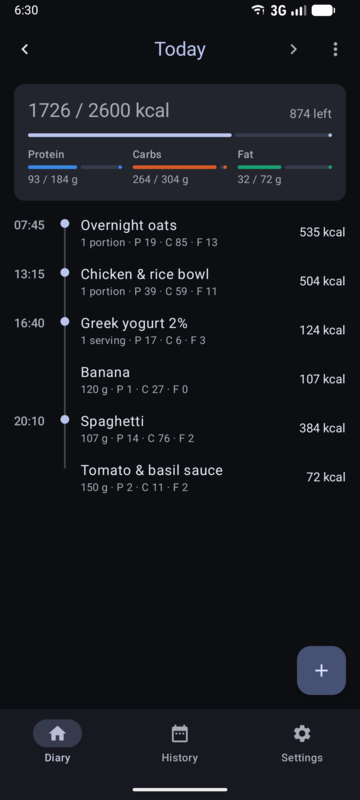
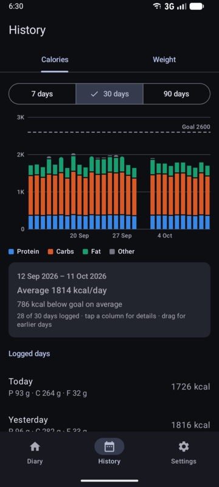
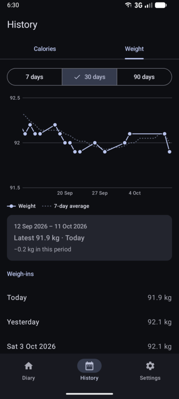
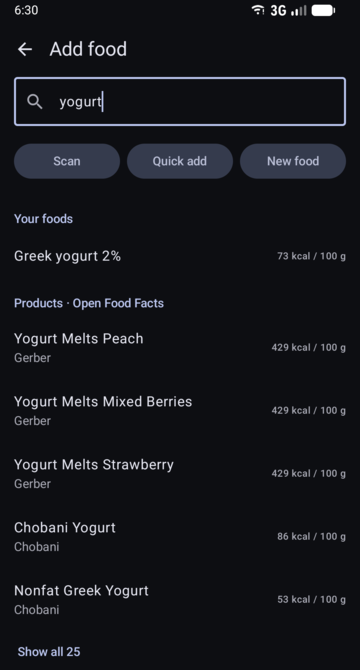

# CalTracker

A calorie and macro tracker for Android that keeps your data on your phone. No account, no ads, no tracking.

<p>
  
  
  
  
</p>

## Features

- **Timeline diary.** Every entry has a time; no breakfast/lunch/dinner boxes. Swipe between days.
- **Find food fast.** Search your saved foods, [Open Food Facts](https://world.openfoodfacts.org) (packaged products) and [USDA FoodData Central](https://fdc.nal.usda.gov) (generic foods), or scan a barcode. Unknown products open a pre-filled form.

> **Tip:** USDA search uses a shared key that allows only a few searches per hour. Get your own [free key](https://fdc.nal.usda.gov/api-key-signup) (1,000 searches per hour) and add it in **Settings → Food search**.
- **Quick add** calories and macros without creating a food.
- **Recipes.** Group foods, log portions or grams (with an optional cooked weight), split a logged recipe back into ingredients, or turn selected diary entries into a recipe.
- **Edit the diary freely.** Change amounts and times, duplicate, copy or move entries to another day, copy a whole day, undo deletes.
- **Goals.** Set your calories and get protein, carbs and fat calculated from your weight (Mifflin-St Jeor), or set everything yourself.
- **History.** Stacked column chart of daily calories by macro with your goal line, and a weight chart with a 7-day average. Logging your weight keeps calculated macros up to date.
- **Home-screen widget** with today's calories and macros.
- **Your data stays yours.** JSON backup/restore to move phones, and export to Excel (`.xlsx`) for your own analysis.

## Install

Download the APK from the [latest release](https://github.com/azr4e1/caltracker/releases/latest) and open it on your phone (you'll be asked to allow installing apps from your browser or file manager).

To get updates automatically, add this repository to [Obtainium](https://github.com/ImranR98/Obtainium).

Requires Android 12 or newer.

## Build from source

Requirements: JDK 21 and the Android SDK (Android Studio installs it).

```bash
git clone https://github.com/azr4e1/caltracker.git
cd caltracker
./gradlew installDebug        # build and install a debug build on a connected phone
./gradlew assembleRelease     # optimized build in app/build/outputs/apk/release/
```

Optional settings in `local.properties` and `keystore.properties` (both git-ignored):

- `usda.apiKey=...` — a [USDA API key](https://fdc.nal.usda.gov/api-key-signup) built into your builds. Without it, USDA's shared, heavily rate-limited `DEMO_KEY` is used.
- `keystore.properties` with `storeFile`, `storePassword`, `keyAlias`, `keyPassword` — signs release builds. Without it, release builds are unsigned.

Built with Kotlin, Jetpack Compose, Room, Glance and fastexcel.

## Privacy

Everything you log is stored only on your device. The app connects to the internet only to search Open Food Facts and USDA, sending the search text or the scanned barcode. Barcode scanning uses Google Play services' code scanner, which runs on the device and needs no camera permission for this app.

## Data sources

- Food data from [Open Food Facts](https://world.openfoodfacts.org), available under the [Open Database License](https://opendatacommons.org/licenses/odbl/1-0/).
- Generic food data from [USDA FoodData Central](https://fdc.nal.usda.gov), public domain.

## License

Copyright © 2026 Lorenzo Drumond

This program is free software: you can redistribute it and/or modify it under the terms of the GNU General Public License as published by the Free Software Foundation, either version 3 of the License, or (at your option) any later version. See [LICENSE](LICENSE).
